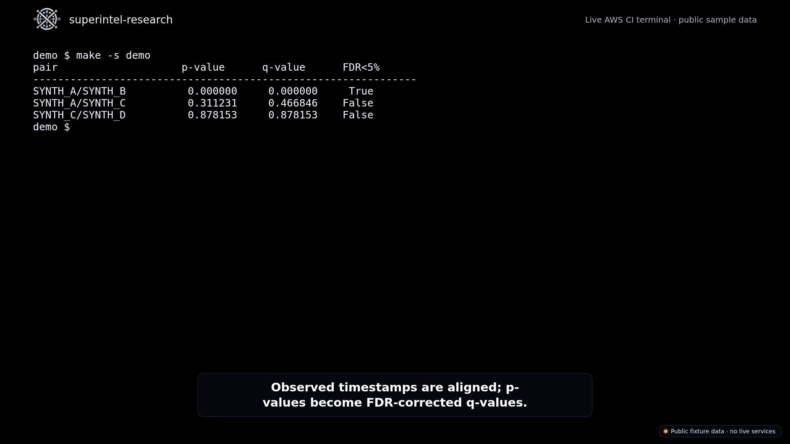

# SuperIntel Research

**Quant research engineering with a deliberately narrow simulation boundary.**

**Maturity: Prototype.** This research extract runs locally and in CI demos. The private SuperIntel system belongs to CorrelateX and has run on real money in small size; this extract contains only research and paper simulation.

CorrelateX research by Ayush Verma. See also [HedgeVision](https://github.com/ayush108108/hedgevision), Ayush's personal open-source research prototype.

A deliberately scoped public extract of a larger quantitative research system. It demonstrates timestamp-correct pair alignment, multiple-hypothesis control, content-addressed datasets, purged walk-forward evaluation, and a deterministic policy-to-paper-broker path.

> **Research and simulation, not a trading product.** This repository contains no live broker connectivity and publishes no proprietary candidate ranking, feature fusion, alpha policy, portfolio allocation, or deployment logic. It makes no profitability claim.

## Demo

Every number in the video is output of the bundled sample data or a paper simulation on synthetic data, not a result or a performance claim.

[](docs/demo/demo.mp4)

The recording shows synthetic database seed status, timestamp-aligned statistics and FDR diagnostics, a toy paper simulation, test output, and the documented public boundary and negative research posture.

Reproduce the recorded workflow with the [quickstart prerequisites](#quick-start):

```bash
make bootstrap
make -s db-status
make -s demo
make -s demo-paper
make -s test
sed -n 1,24p docs/PUBLIC_BOUNDARY.md
sed -n 1,13p docs/RESULTS.md
```

## Why this exists

The difficult part of a quant system is not drawing a chart or fitting a model. It is making invalid experiments difficult to run and easy to detect.

This extract focuses on seven invariants:

1. **Market time is explicit.** Pair legs are aligned by observed event time; missing observations are not silently forward-filled.
2. **Multiple testing is controlled.** Candidate families use Benjamini–Hochberg FDR correction instead of treating every nominal p-value as an independent discovery.
3. **Datasets are auditable.** Feature/label alignment produces deterministic schema and snapshot identities.
4. **Validation is temporal.** Labels are point-in-time, folds include a purge gap, and preprocessing is fitted only on the training window.
5. **Prediction is not PnL.** Classification metrics and economic outcome metrics are reported separately.
6. **Storage is replaceable.** Research logic consumes an explicit market-data interface rather than depending directly on a private database implementation.
7. **Alpha is replaceable.** A public `TradingPolicy` protocol separates generic simulation from private decision logic.

## Public research pipeline

```text
observed price histories
        |
        +--> in-memory/synthetic data
        |
        +--> TimescaleDB research.market_bars
        |
        v
canonical event-time alignment
        |
        v
Engle-Granger + residual diagnostics
        |
        v
Benjamini-Hochberg FDR control
        |
        v
point-in-time labels + dataset identity
        |
        v
purged walk-forward evaluation
        |
        +--> classification metrics
        |
        +--> economic outcome metrics
        |
        +--> toy policy -> long-only paper broker -> local simulation API
```

The private system continues beyond this boundary into proprietary research, scoring/fusion, alpha policies, portfolio/risk policy, live broker integration and operations. Those implementations are intentionally absent.

## Repository map

```text
Makefile                         # canonical public control surface
docker-compose.research.yml      # localhost-only TimescaleDB
frontend/                        # same-origin research/simulation console

db/
├── migrations/001_market_bars.sql
└── README.md

scripts/
├── seed_pilot_data.py           # deterministic synthetic Timescale seed
└── timescale_demo.py            # DB -> statistics/FDR demonstration

holiday_data/
└── exchange_holidays.csv        # small illustrative subset of exchange-published holiday calendars

src/superintel_research/
├── statistics/
│   ├── pair_alignment.py        # canonical event-time intersection
│   ├── cointegration.py         # sanitized Engle-Granger reference
│   └── multiple_testing.py      # BH/FDR + deterministic family identity
├── datasets/
│   ├── assembler.py             # aligned dataset + deterministic identity
│   ├── label_construction.py    # generic cost-aware future outcomes
│   └── temporal_split.py        # rolling folds with purge gaps
├── evaluation/
│   ├── classification_metrics.py
│   ├── trading_metrics.py
│   └── walk_forward.py          # train-only preprocessing per fold
├── storage/
│   ├── protocol.py              # replaceable market-data contract
│   └── timescale.py             # public OHLCV-only Timescale adapter
├── trading/
│   ├── protocol.py              # private-alpha extension boundary
│   └── toy_policy.py            # explicitly illustrative policy
├── broker/
│   ├── protocol.py              # broker-neutral contract
│   └── paper_broker.py          # deterministic long-only simulation
└── backend/                      # local research/simulation API

examples/
├── synthetic_pair_research.py
└── paper_execution_simulation.py

tests/
docs/
config/research.example.toml
```

## Quick start

Requires Python 3.12+, Docker, Docker Compose, and `make`.

The canonical path is intentionally small. On a machine with the prerequisites, it takes under ten minutes:

```bash
make bootstrap
make demo
make demo-paper
make test
```

`make bootstrap`:

```text
Python environment
    -> local TimescaleDB
    -> public migration
    -> deterministic pilot seed
    -> DB status check
```

`make demo` then performs:

```text
TimescaleDB
    -> bounded market-bar query
    -> timestamp alignment
    -> cointegration diagnostics
    -> BH/FDR correction
```

The seeded dataset contains only four deterministic synthetic symbols and is intended as a reproducibility fixture, not market data.

If Docker/Timescale is not desired, the original in-memory path remains available:

```bash
make setup
make demo-synthetic
make demo-paper
make backend
```

The local console is then available at `http://localhost:8000/`; OpenAPI documentation is at `http://localhost:8000/docs`.

## Bring your own data

The included seed is intentionally small. Populate the same `research.market_bars` contract with your own lawful historical OHLCV data and the public storage adapter can feed the same research pipeline without changing the statistical modules.

The repository intentionally does **not** prescribe or publish a private data vendor, asset universe, ingestion policy, feature store, candidate-selection policy, or alpha configuration.

## What the code demonstrates

### Temporal correctness

`pair_alignment.py` aligns two independently observed histories on their actual shared timestamps. It makes duplicate resolution explicit and rejects invalid price data rather than silently coercing it.

### Statistical discipline

`cointegration.py` exposes standard Engle–Granger/ADF diagnostics but deliberately stops before proprietary candidate scoring. `multiple_testing.py` applies Benjamini–Hochberg correction across a hypothesis family.

### Reproducible datasets

`DatasetAssembler` joins features and labels on a shared ordered index, removes incomplete rows, hashes their content and schema, and derives a deterministic snapshot identifier.

### Leakage-aware evaluation

`WalkForwardSplitter` creates chronological folds with a purge gap. `WalkForwardEvaluator` fits preprocessing inside the training fold and applies it to the test fold; no full-sample normalization is used.

### Replaceable storage

`MarketDataStore` is the public read contract. `TimescaleMarketDataStore` implements that contract against the intentionally narrow `research.market_bars` hypertable. Private feature, signal, execution and operational schemas are not part of this repository.

### Pluggable alpha boundary

`TradingPolicy` accepts a minimal point-in-time snapshot and returns a broker-neutral intent. The included `ToyThresholdPolicy` exists only to exercise the contract. Private SuperIntel policies, parameters and portfolio logic are not published.

### Honest paper execution

`PaperBrokerAdapter` is a deterministic, long-only market-order simulator with fees, slippage, inventory checks, client-order idempotency and PnL reconciliation. It is not presented as a live-broker adapter.

The default order notional cap is deliberately small: $10,000, a toy limit for research and paper simulation.

### Honest reporting

The larger private research program produced useful negative results: early supervised and learned-ranking experiments did not establish a durable economic edge after costs at the evaluated data size. The public record keeps that conclusion because rejecting weak evidence is part of the engineering standard.

## Make targets

```text
make setup           Python environment + dependencies
make bootstrap       setup + Timescale + migrate + seed
make db-up           start TimescaleDB
make db-migrate      apply public schema
make db-seed         seed deterministic pilot bars
make db-status       inspect symbol/time coverage
make db-shell        open psql
make db-down         stop TimescaleDB
make db-reset        recreate only the public research DB volume
make demo            DB-backed research demonstration
make demo-synthetic  in-memory research demonstration
make demo-paper      deterministic policy-to-broker simulation
make backend         localhost simulation API
make test            tests
make coverage        tests + coverage report (terminal, XML, HTML)
make lint            Ruff
make audit           dependency audit
make ci              fail-closed local quality gate
```

## Documentation

| Document | Purpose |
|---|---|
| [`ARCHITECTURE.md`](docs/ARCHITECTURE.md) | Component boundaries and invariants |
| [`METHODOLOGY.md`](docs/METHODOLOGY.md) | Statistical and temporal methodology |
| [`RESULTS.md`](docs/RESULTS.md) | What the research established and did not establish |
| [`REPRODUCIBILITY.md`](docs/REPRODUCIBILITY.md) | Environment and verification commands |
| [`PUBLIC_BOUNDARY.md`](docs/PUBLIC_BOUNDARY.md) | Explicit public/private IP boundary |
| [`db/README.md`](db/README.md) | Public Timescale schema and bring-your-own-data boundary |

## Verification

The local quality gate is:

```bash
make ci
```

GitHub Actions additionally measures test coverage, boots TimescaleDB, applies the migration, seeds pilot bars, runs the DB-backed demonstration and the deterministic paper-broker simulation. Checks are fail-closed; there are no `|| true` or `continue-on-error` escapes in the public quality gate.

The measured coverage number is published as a run artifact (`coverage.xml` and an HTML report) on every CI run. The preparation CI run for this repository measured 84% (880 statements); the number attached to each run is authoritative.

## Scope and non-claims

This is research code, not financial advice. It does not claim profitable alpha, production readiness, or suitability for live trading.

Private datasets, exact candidate scores, feature-fusion logic, alpha policies, strategy parameters, portfolio/risk policy, live broker routing, credentials, operational topology and runtime state are intentionally excluded.

## License

MIT. See [`LICENSE`](LICENSE).
